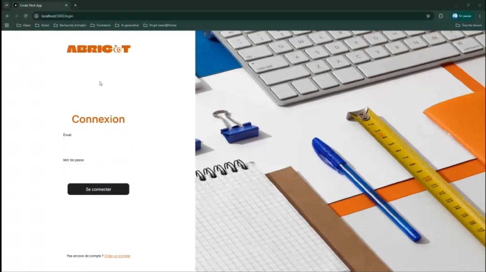
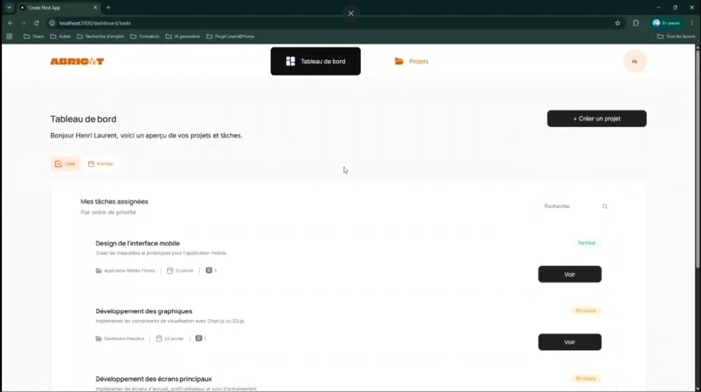
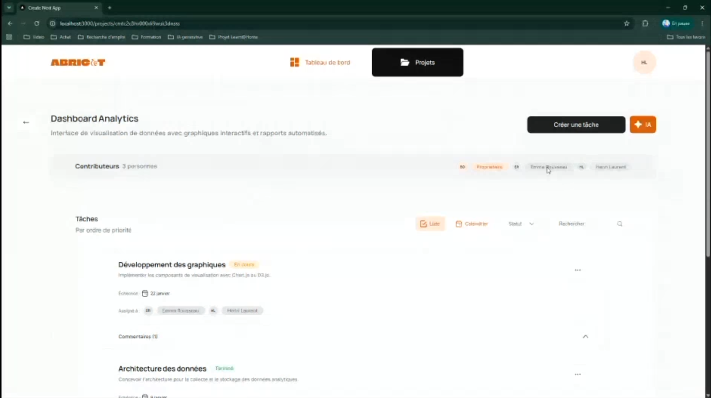

# Abricot

Application SaaS de gestion de projets collaboratifs : projets, tâches, commentaires, et génération de tâches par IA. Projet réalisé dans le cadre de la formation OpenClassrooms (Développeur d'application full stack).




<!-- À ajouter : 3 ou 4 captures dans docs/ (tableau de bord, projet, génération de tâches) -->

## Fonctionnalités

- Authentification (connexion et déconnexion) avec session par cookie `httpOnly` et JWT
- Gestion de projets : création, consultation, mise à jour
- Gestion de tâches
- Système de commentaires
- Génération de tâches par IA (API Gemini) : l'utilisateur décrit ce qu'il veut faire, les tâches proposées peuvent être modifiées ou supprimées avant d'être créées
- Mise à jour du profil
- Recherche et navigation contextuelle
- Interface accessible, conforme aux exigences **WCAG** (audits WAVE)
- Compatible mobile

## Stack technique

- **Next.js 16** (App Router, Server Components, Server Actions) et **React 19**, en JavaScript (JSX)
- **CSS Modules**, approche desktop-first avec des breakpoints `max-width`, à partir de maquettes Figma
- **API Gemini** (Google) pour la génération de tâches
- Backend fourni par OpenClassrooms (Express et Prisma), non modifiable : [dev-react-P10](https://github.com/OpenClassrooms-Student-Center/dev-react-P10)

## Architecture

- **Server Actions** comme pont entre l'application et l'API backend : le token reste côté serveur.
- **Server Components** pour charger les données, transmises ensuite aux composants clients en props.
- **React Contexts** pour l'état client : `AuthContext`, `ProjectContext`, `TaskContext`, `CommentContext`, `DashboardContext`.
- Un layout `(protected)` précharge les données de l'utilisateur et du projet côté serveur.

## Lancer le projet

Prérequis : [Node.js](https://nodejs.org/) et npm.

**1. Démarrer le backend**, en suivant les instructions du dépôt [dev-react-P10](https://github.com/OpenClassrooms-Student-Center/dev-react-P10).

**2. Démarrer le front**

```bash
git clone https://github.com/Predatorium/Abricot.git
cd Abricot
npm install
cp .env.example .env
```

Dans `.env`, renseigne :

| Variable | Rôle |
|---|---|
| `API_URL` | URL de l'API backend (par exemple `http://localhost:XXXX`, selon le port de ton backend) |
| `REACT_ENV` | Environnement (`production` dans le fichier d'exemple) |
| `GEMINI_API_KEY` | Clé de l'API Gemini, nécessaire à la génération de tâches |

Puis :

```bash
npm run dev
```

Le serveur de développement est lancé avec `-H 0.0.0.0` : l'application est accessible depuis un téléphone du même réseau local, utile pour tester la version mobile.

## Scripts

| Commande | Rôle |
|---|---|
| `npm run dev` | Serveur de développement |
| `npm run build` | Build de production |
| `npm start` | Lance le build de production |
| `npm run lint` | Analyse du code avec ESLint |

## Choix et apprentissages

- Server Actions plutôt que des appels directs depuis le navigateur, pour ne jamais exposer le token JWT.
- Modales de création et d'édition pilotées par un état React (contexte) plutôt que par des routes.
- Composants réutilisables : `UserMultiSelect` (mode local ou asynchrone), `InputLabel`, `Button`, `Tag`, `Chip`.
- Accessibilité vérifiée avec les audits WAVE.
- Un journal des échanges avec l'IA utilisée pendant le projet est disponible dans le fichier [`Journal_IA`](Journal_IA).

Avec ce projet j'ai appris à utiliser Next.js, notamment son système de routing, il m'as aussi permis de gerer les permissions en fonction du status de l'utilisateur sur ce qui lui appartient.

## Auteur

Laurent Canonge · [GitHub](https://github.com/Predatorium) · [LinkedIn à ajouter]
